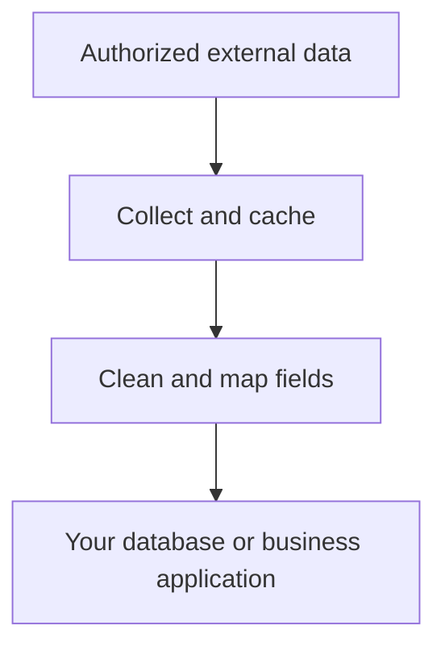

# catalog-sync

[Chinese (zh-CN)](README.zh-CN.md) · **v0.1.0rc1 release candidate** · MIT

## Bring data from the services you use into the platform you build.

For technical teams connecting SaaS or enterprise data services to their own applications: **collect authorized data → clean and map it → load it**, in one repeatable workflow.

For example, bring an authorized supplier catalog into an internal purchasing system, with consistent units and repeatable updates.

### Who it is for

- **Platform and backend teams** bringing authorized external records into purchasing, supplier management or other business applications.
- **Data engineers and integration teams** replacing one-off import scripts with repeatable mappings, recovery and update rules.
- **Python developers** building reusable connectors or receiving adapters for the services their teams use.

### What it helps you do

- **Create consistent records.** Map fields, parse units and apply missing-value rules without inventing missing data.
- **Repeat imports with clear update rules.** Resume collection and preserve application-owned fields according to your configuration.
- **Avoid collecting the same data just to change a mapping.** Keep raw responses, reprocess them offline and identify failed items.

### The workflow



Configure the **source, transformation rules and destination**. Real sources need a compatible connector; business applications need a receiving endpoint or adapter.

### One command. A complete result.

Install and start Docker, download this repository, then run from its root:

```sh
sh tools/demo.sh
```

The demo collects synthetic data, cleans it, imports it and opens a report showing **before-and-after values, stored records and repeat-import checks**. No real account or host Python installation is needed.

It includes **24 materials and 9 suppliers**; materials are written to both a local database and a reference receiver. The first run downloads dependencies. Use macOS, Linux, or Windows with Docker-integrated WSL.

### Scope and validation

The first version covers material and supplier records, with the framework, synthetic source and connector scaffolding. Adapt real services yourself. Generic web scraping and automated CAPTCHA bypass are outside this release.

The candidate code passed Python 3.11–3.13 checks, the Docker workflow and **18 acceptance checks**. See [tested scope and limitations](docs/acceptance.md); this does not establish compatibility with arbitrary external services.

[Full user guide](docs/README.md) · [Build a connector](docs/connector-guide.md) · [Data rules](docs/data-contract.md) · [Receiver contract](docs/platform-contract.md) · [Deployment](docs/deploy.md)

### Build the next connection together

Contributions can start with:

- **More sources and destinations:** connectors for authorized APIs and adapters for business application receivers.
- **Better normalization:** mappings, unit handling and synthetic examples for new data shapes.
- **An easier first run:** clearer documentation, reproducible bug reports and small fixes.

Start an [issue](https://github.com/wangxuzhou666-arch/catalog-sync/issues) describing your source, destination and the gap you encountered. Discuss the scope, then submit a focused pull request using the [contribution guide](CONTRIBUTING.md). Use synthetic examples, never real credentials or customer data. You are welcome to help maintain the connectors, tests and documentation you contribute.

Only process data you are authorized to access and export, and follow the source service's terms. [Responsible use](docs/compliance.md) · [Security](SECURITY.md) · [License](LICENSE)
