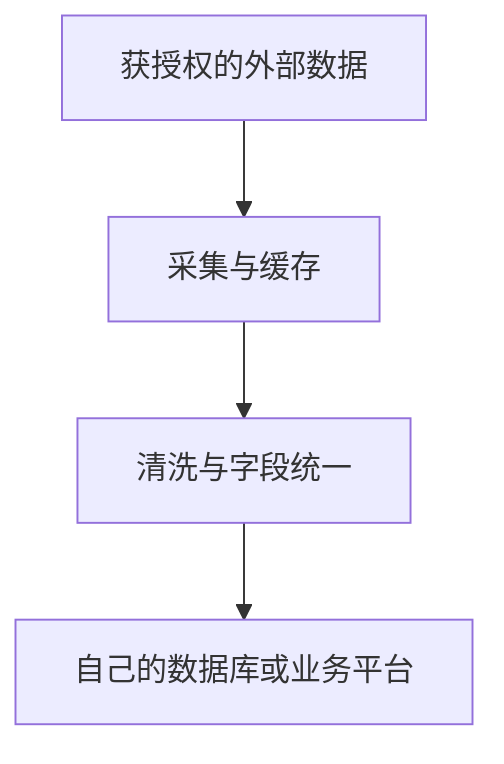

# catalog-sync

[English](README.md) · **v0.1.0rc1 候选版** · MIT

## 把外部数据，变成自己平台能用的数据。

面向需要接入 SaaS 或企业数据服务的技术团队，把**授权采集 → 清洗与字段统一 → 导入**串成一条可重复运行的流程。

例如，把有权访问的供应商目录接入内部采购系统，统一单位和字段，之后按同一套规则更新。

### 解决什么问题

拿到外部服务的数据后，往往还要自己写脚本整理格式、对齐字段，再处理导入失败和重复更新。catalog-sync 把这些步骤放进同一套流程，让接入规则可以配置、复用和追查。

### 能帮你做什么

- **把数据整理成统一记录。** 映射字段、解析单位、按规则处理缺失值；不会猜测缺失内容。
- **让同步可以重复运行。** 支持续传和重复导入，并按配置保留目标平台自己维护的字段。
- **少做重复采集。** 保留原始响应，清洗规则变了可以离线重处理；失败条目留有记录。

### 核心流程



你配置**来源、清洗规则和目标**，框架把它们串起来。真实来源需要适配连接器，目标业务平台需要接收接口或适配层。

### 一条命令，看到完整结果

安装并启动 Docker，下载本仓库，在仓库根目录运行：

```sh
sh tools/demo.sh
```

自动采集合成数据、清洗并导入，打开报告查看**清洗前后、实际入库结果和重复导入验证**。不需要真实账号，也不需要安装 Python。

示例包含 **24 条物料、9 条供应商**；物料同时写入本地数据库和参考接收端。首次运行需要下载依赖。支持 macOS、Linux；Windows 使用已接通 Docker 的 WSL。

### 当前范围与验证

第一版面向物料和供应商记录，提供框架、模拟来源和连接器脚手架。真实服务需自行适配；不包含通用网页抓取或自动绕过验证码。

候选代码已通过 Python 3.11–3.13、Docker 链路和 **18 项完整验收**。具体覆盖与限制见[验收说明](docs/acceptance.md)；这些验证不代表任意外部服务已接通。

[完整使用手册](docs/README.zh-CN.md) · [编写连接器](docs/connector-guide.md) · [数据规则](docs/data-contract.md) · [接收端接口](docs/platform-contract.md) · [部署指南](docs/deploy.md)

仅处理你有权访问和导出的数据，并遵守来源服务条款。[使用边界](docs/compliance.md) · [安全反馈](SECURITY.md) · [许可证](LICENSE)
